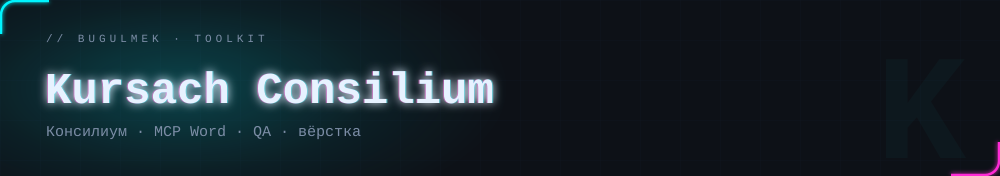
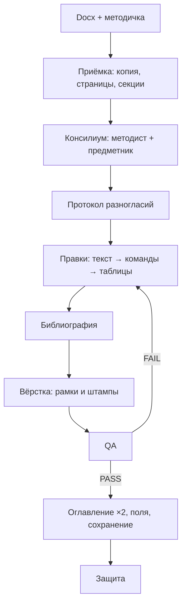

<!-- neon:header:start -->
<p align="center">
  
</p>
<!-- neon:header:end -->

<p align="center">
  
  
  
  
  
</p>

Набор методик и инструментов, чтобы **самостоятельно** довести курсовую или дипломную работу в Word до защиты: проверить по методичке, собрать замечания, внести правки, привести рамки и штампы, проверить библиографию и не потерять вёрстку.

> Это **не готовая работа** и не чужой курсовой. Здесь нет текстов чужих проектов, ФИО, групп и тем. Только процесс, шаблоны и скрипты, которые применяются к **вашему** документу.

## Зачем

- Преподаватель дал список замечаний, но непонятно, с чего начать.
- Оформление «поехало»: рамки, штампы, оглавление, нумерация.
- Список источников не сходится с ссылками в тексте.
- Нужно проверить документ перед сдачей, а не после.

## Что умеет

| Блок | Что делает |
|---|---|
| Консилиум | два независимых вердикта: методист (форма) и предметник (содержание) |
| Протокол | спорные пункты сводятся в таблицу с решениями и обоснованиями |
| Правки | замена текста, вставка абзацев/таблиц, безопасная работа с docx |
| Вёрстка | секции, титул, содержание, полоса «Лист N», `PAGE`/`NUMPAGES` |
| Библиография | ГОСТ, покрытие ссылок `[n]`, дубли, недоступные источники |
| QA | проверка заглушек, ссылок, дублей, подписей, штампов |
| MCP | `word-live` и `browse`: живые правки в Word и проверка в браузере |
| Скил | готовый сценарий для агента: от приёмки до финализации |

## Быстрый старт

```powershell
# 1. Копия
Copy-Item thesis.docx thesis.before.docx

# 2. Факты о документе
python -X utf8 scripts\consilium\docx_tools.py info thesis.docx

# 3. Текст для проверки
python -X utf8 scripts\consilium\docx_tools.py text thesis.docx --out dump.txt

# 4. Замена фразы (с резервной копией)
python -X utf8 scripts\consilium\docx_tools.py replace thesis.docx "старая фраза" "новая фраза"

# 5. QA
python -X utf8 scripts\consilium\qa_docx.py thesis.docx --sources 20 --require-stamp
```

## Процесс



Подробно: [инструкция](docs/01-INSTRUCTION.md).

## MCP-сервер

Word управляется через локальный MCP-сервер `word-live` (COM), браузер — через `browse`. Это позволяет агенту:

- находить и заменять текст в открытом Word;
- вставлять абзацы и форматировать;
- делать скриншот реального экрана Word;
- обновлять поля и оглавление;
- проверять источники в браузере.

Конфиг: [`mcp/opencode.mcp.json`](mcp/opencode.mcp.json). Подробно: [MCP-сервер](docs/02-MCP-SERVER.md).

```json
{
  "mcp": {
    "word-live": {
      "type": "local",
      "command": ["...uvx.exe", "--from", "word-mcp-live", "word_mcp_server.exe"]
    }
  }
}
```

## Скил

[`skills/kursach-consilium/SKILL.md`](skills/kursach-consilium/SKILL.md) — готовый сценарий для агента:

- когда применять;
- какие входы нужны;
- промпты методиста и предметника;
- порядок правок;
- QA-гейты;
- грабли Word/COM/MCP.

Скил можно скопировать в `~/.claude/skills` или `~/.config/opencode/skills`.

## Что внутри

```
assets/
  neon-header.svg     баннер README
  neon-footer.svg     футер README
  social-preview.png  превью 1280×640
docs/
  01-INSTRUCTION.md   полная инструкция
  02-MCP-SERVER.md    word-live, browse, COM
  03-CHECKLIST.md     короткий чек-лист
skills/
  kursach-consilium/
    SKILL.md
    references/
      qa-gates.md
      word-recipes.md
mcp/
  opencode.mcp.json
  README.md
scripts/
  consilium/
    docx_tools.py
    qa_docx.py
    example.qa.json
  word-com/
    open_doc.ps1
    goto_page.ps1
    desktop_shot.ps1
    zoom.ps1
    close_all.ps1
    update_fields.ps1
```

## Оформление

- баннер и футер — `assets/neon-header.svg` и `assets/neon-footer.svg`, уже вставлены в README;
- social preview 1280×640 — `assets/social-preview.png`;
- загрузить превью: **Settings → Social preview → Upload image** (GitHub API этого не умеет).

## Требования

- Windows + Microsoft Word (для COM и `word-live`).
- Python 3.10+.
- `uv`/`uvx` — для `word-mcp-live`.
- `browse` — для браузерного MCP (опционально).

## Академическая честность

Инструменты помогают с оформлением, проверкой и автоматизацией. Они не пишут содержательную часть за студента и не выдумывают результаты. Если вуз требует раскрывать использование ИИ — раскройте. Если работа уже принята руководителем, изменения — только после согласования.

## Лицензия

MIT. См. [LICENSE](LICENSE).

<!-- neon:footer:start -->
<p align="center">
  
</p>
<!-- neon:footer:end -->
