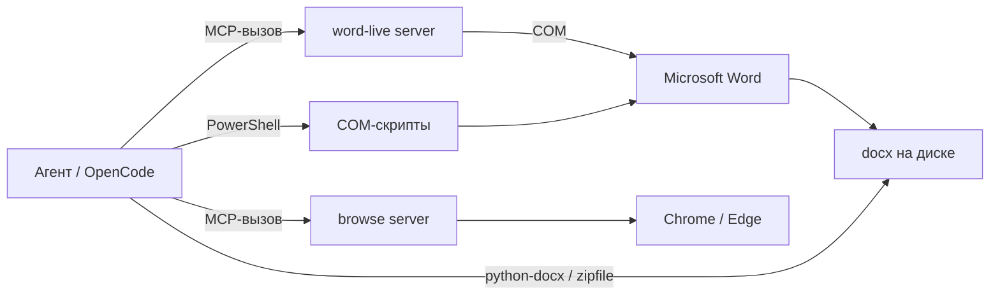

# MCP-сервер: word-live, browse и COM-мост

Этот документ описывает инструменты, которыми выполнялась работа с Word и браузером. Он не требует знания внутренностей агента: достаточно понять, какие процессы запущены, какие инструменты доступны и в каком порядке их вызывать.

---

## 1. Что такое MCP в этой схеме

MCP (Model Context Protocol) — локальный сервер, который отдаёт агенту инструменты в виде функций. Агент не «кликает по Word» наугад: он вызывает `word_live_replace_text`, сервер через COM обращается к открытому Word, возвращает результат.



Три слоя:

| Слой | Когда использовать | Риск |
|---|---|---|
| `word-live` MCP | Word открыт, нужна живая правка и проверка «глазами» | средний: работает с открытым документом |
| PowerShell COM | массовые операции, обновление полей, замер страниц | средний: требует аккуратных скриптов |
| python-docx / OOXML | массовые вставки, хирургия секций, работа при закрытом Word | низкий для файла, высокий для структуры |

---

## 2. Конфигурация

### 2.1. Нативный формат OpenCode

Файл `opencode.json` (обычно `%USERPROFILE%\.config\opencode\opencode.json`):

```json
{
  "$schema": "https://opencode.ai/config.json",
  "mcp": {
    "browse": {
      "type": "local",
      "command": ["C:\\Users\\<user>\\.local\\bin\\browse.exe", "mcp"],
      "cwd": "~",
      "pool": true,
      "environment": {
        "OPENCODE_BROWSER_RUNTIME": "auto-update"
      }
    },
    "word-live": {
      "type": "local",
      "command": [
        "C:\\Users\\<user>\\.local\\bin\\uvx.exe",
        "--from",
        "word-mcp-live",
        "word_mcp_server.exe"
      ],
      "timeout": {
        "startup": 120000,
        "catalog": 60000
      }
    }
  }
}
```

Готовый фрагмент лежит в [`mcp/opencode.mcp.json`](../mcp/opencode.mcp.json).

### 2.2. Вариант с обёрткой `servers`

В некоторых сборках OpenCode конфиг оборачивают в ключ `servers`:

```json
{
  "mcp": {
    "servers": {
      "browse": { "...": "..." },
      "word-live": { "...": "..." }
    }
  }
}
```

Если ваш OpenCode не видит инструменты, проверьте, какой формат он ожидает: нативный (`mcp.<name>`) или обёртку (`mcp.servers.<name>`). Внутренности серверов одинаковые.

### 2.3. Требования

- Windows с установленным **Microsoft Word** (для `word_live_*` нужен COM).
- `uv`/`uvx` в `PATH` (сервер `word-mcp-live` запускается через `uvx`).
- Для `browse` — установленное браузерное расширение OpenCode и `browse.exe`.
- Word должен быть **открыт** для живых инструментов. Файловые инструменты работают и при закрытом Word.

### 2.4. Проверка

1. Перезапустить OpenCode.
2. Убедиться, что в каталоге инструментов появились `word_live_*` и `browse`.
3. Открыть тестовый docx в Word.
4. Вызвать `word_live_get_info` — должен вернуть имя файла, число страниц и слов.
5. Вызвать `word_screen_capture` — должен появиться PNG с реальным экраном Word.

Если инструментов нет — смотреть лог MCP-сервера и проверять путь к `uvx.exe`/`browse.exe`.

---

## 3. word-live: живые инструменты

### 3.1. Основные

| Инструмент | Назначение | Особенности |
|---|---|---|
| `word_live_get_info` | имя файла, страницы, слова | быстрый статус |
| `word_live_get_text` | весь текст по абзацам | для больших документов лучше `get_page_text` |
| `word_live_get_page_text` | текст конкретных страниц | удобно для проверки раздела |
| `word_live_find_text` | поиск с контекстом | возвращает смещения и контекст |
| `word_live_replace_text` | найти и заменить | лимит ~255 символов на строку |
| `word_live_delete_text` | удалить по смещениям | смещения — символьные |
| `word_live_insert_text` | вставить текст | позиция `start`/`end`/закладка |
| `word_live_format_text` | шрифт, цвет, стиль, выравнивание | по смещениям или абзацам |
| `word_live_save` | сохранить | можно указать `save_as` |
| `word_screen_capture` | скриншот экрана Word | главный инструмент проверки «глазами» |

### 3.2. Рабочий цикл правки

```text
1. word_live_find_text  → найти точную фразу и смещение
2. word_live_replace_text → заменить (дробить длинные строки)
3. word_screen_capture + read PNG → проверить на экране
4. Если изменилась длина текста:
   `update_fields.ps1` → `qa_docx.py`
5. word_live_save
```

### 3.3. Грабли (проверено на этом проекте)

| Проблема | Что происходит | Решение |
|---|---|---|
| Лимит 255 символов | длинная замена обрезается | дробить на несколько вызовов |
| `insert_paragraphs` / `insert_image` | вставляют **в позицию курсора**, а не в индекс абзаца | файловые вставки — только python-docx при закрытом Word |
| `get_paragraph_text_from_document` | читает файл с диска и «устаревает», пока Word не сохранён | для живого состояния — `word_live_*` или COM |
| Inline-картинка | Word Find не находит символ изображения | искать по соседнему тексту |
| `Range.Text = ...` | может вернуть `pageBreakBefore` строкам оглавления | после замены выставить `PageBreakBefore = $false` |
| Русские строки в inline-PowerShell | ломаются | писать `.ps1` в UTF-8 **с BOM** |
| Перебор коллекций COM | `foreach` молча не работает | только `$doc.Sections.Item(i)` |
| Word перенумеровал части | `header1`/`header2` поменялись местами | сверять по содержимому, а не по номеру |

---

## 4. browse: браузерный MCP

Использовался для:

- проверки доступности источников (если домен не резолвится — NXDOMAIN);
- поиска ГОСТ и RFC;
- проверки GitHub-репозитория после публикации;
- скриншотов страниц.

Базовый цикл:

```text
1. snapshot() → семантический снимок страницы и ссылки
2. ref("e12").click() / page.getByRole(...).fill(...)
3. Проверка: page.url(), заголовок, свежий snapshot()
```

Правила:

- не решать капчу и не обходить блокировки — `handoff()` пользователю;
- для чувствительных сессий задавать allowlist;
- не вставлять логины/пароли в код.

---

## 5. PowerShell COM-мост

Скрипты лежат в [`scripts/word-com/`](../scripts/word-com/).

| Скрипт | Что делает |
|---|---|
| `open_doc.ps1` | открыть docx, опционально обновить поля и оглавление, задать зум |
| `goto_page.ps1` | перейти к странице в открытом документе |
| `desktop_shot.ps1` | снять весь экран в PNG |
| `zoom.ps1` | изменить масштаб активного окна |
| `close_all.ps1` | закрыть все документы и выйти из Word |
| `update_fields.ps1` | обновить поля и оглавление, сохранить и закрыть |

Ключевые приёмы:

```powershell
# страница абзаца
$p.Range.Information(3)

# всего страниц
$doc.Repaginate()
$doc.ComputeStatistics(2)

# оглавление — дважды
$doc.TablesOfContents.Item(1).Update()
$doc.Repaginate()
$doc.TablesOfContents.Item(1).Update()
```

Все скрипты с кириллицей сохраняются в UTF-8 с BOM. Иначе PowerShell читает их как ANSI и портит строки.

---

## 6. python-docx и OOXML

Когда Word закрыт, безопаснее работать с файлом напрямую:

```python
import zipfile

with zipfile.ZipFile(path) as z:
    entries = {n: z.read(n) for n in z.namelist()}

doc = entries['word/document.xml'].decode('utf-8')
# ... правки ...
entries['word/document.xml'] = doc.encode('utf-8')

with zipfile.ZipFile(path, 'w', zipfile.ZIP_DEFLATED) as z:
    for name, data in entries.items():
        z.writestr(name, data)
```

Правила:

1. Всегда делать копию до записи.
2. Не менять `[Content_Types].xml` без необходимости.
3. Сохранять `xml:space="preserve"` у `w:t`.
4. Проверять, что после записи docx открывается Word.
5. Для вставки абзаца копировать `w:pPr` и `w:rPr` соседнего — иначе «поедет» шрифт.

---

## 7. Рецепты

### 7.1. Заменить фразу в открытом Word

```text
word_live_find_text({ search_text: "старая фраза", context_chars: 80 })
word_live_replace_text({ find_text: "старая фраза", replace_text: "новая фраза" })
word_screen_capture({ output_path: "C:\\...\\check.png" })
```

### 7.2. Вставить блок команд (Word закрыт)

1. Найти абзац-якорь в XML.
2. Собрать новый абзац с `w:pPr`/`w:rPr` якоря.
3. Вставить перед/после.
4. Открыть Word, проверить, обновить поля.

### 7.3. Проверить вёрстку

```text
open_doc.ps1 -Path <docx> -Zoom 70
goto_page.ps1 -Page 2
desktop_shot.ps1 -Out <png>
```

Смотреть: титул без штампа, содержание — по требованию кафедры, с 3-й — полоса, текст не налезает, реквизиты и ФИО чёрные.

### 7.4. Обновить оглавление и поля

```powershell
$doc.Fields.Update()
$doc.Repaginate()
$doc.TablesOfContents.Item(1).Update()
$doc.Repaginate()
$doc.TablesOfContents.Item(1).Update()
$doc.Fields.Update()
$doc.Save()
```

Дважды — потому что после первого обновления меняются номера страниц, и оглавление нужно пересчитать ещё раз.

### 7.5. Посчитать факты о документе

```python
z = zipfile.ZipFile(path)
app = z.read('docProps/app.xml').decode('utf-8')
doc = z.read('word/document.xml').decode('utf-8')
print('страниц:', re.findall(r'<Pages>(\d+)</Pages>', app))
print('секций:', doc.count('<w:sectPr'))
print('таблиц:', doc.count('<w:tbl>'))
print('рисунков:', doc.count('<w:drawing>'))
```

---

## 8. Диагностика

| Симптом | Причина | Что делать |
|---|---|---|
| Word «зависает» при открытии | скрытый диалог о серьёзной ошибке | снять флаг восстановления, открыть заново |
| Инструменты `word_live_*` не появляются | неверный путь к `uvx`, MCP не стартовал | проверить лог, путь, перезапустить OpenCode |
| Замена «не сработала» | строка длиннее 255 символов или разбита на runs | дробить, искать по короткому фрагменту |
| Текст вставился не туда | `insert_paragraphs` вставляет по курсору | использовать python-docx при закрытом Word |
| Оглавление «съехало» | не обновлено после правок | обновить дважды + `Repaginate` |
| Документ «не сохранён» после открытия | поля помечают документ изменённым | сохранить явно, на содержимое не влияет |
| Кириллица в скрипте сломалась | файл без BOM | перезаписать в UTF-8 BOM |

---

## 9. Безопасность

- MCP-сервер с COM имеет **полный доступ к Word** и открытым документам. Не подключайте его к незнакомым файлам с макросами.
- `browse` использует ваш браузерный профиль. Не давайте агенту доступ к банковским и личным вкладкам; используйте allowlist.
- Не храните токены GitHub в тексте скриптов. `gh auth login` хранит их в keyring.
- Перед любыми массовыми правками — копия файла и проверка размера/страниц после записи.
